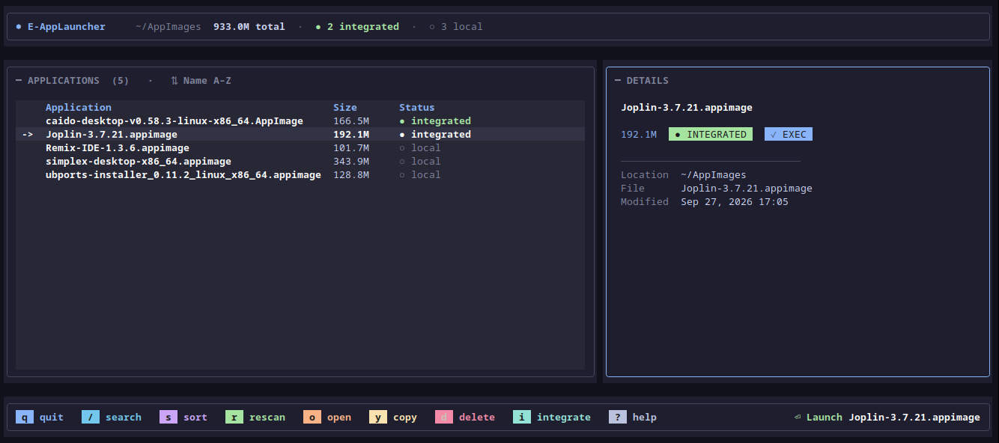

# E-AppLauncher

      


E-AppLauncher is a keyboard-driven launcher for AppImage files on Linux. Point it at a folder once; it indexes every AppImage and gives you a terminal UI to search, inspect, launch, and integrate them into your desktop menu. Useful if you keep AppImages in a dedicated folder and want them launchable without desktop clutter.

## Features

- Keyboard-driven terminal UI for browsing, searching, sorting, and launching AppImages
- Desktop integration toggle to add or remove menu entries and icons
- Scriptable CLI for list, launch, integrate, and update checks
- Multi-folder and recursive scanning with optional watch mode
- Trash-safe delete and clipboard path copy
- Local-only state with automatic recovery from corrupted configs



> [!NOTE]
> Running AppImages needs FUSE (`/dev/fuse` plus `fusermount` or `fusermount3`, i.e. `libfuse2`/`fuse3`). Only launch AppImages from sources you trust - launching one executes it with your user privileges.

## Install

Prebuilt binary via curl (recommended, no Python needed). Linux `x86_64` and
`aarch64` builds are attached to
[GitHub Releases](https://github.com/AegisTrail/E-AppLauncher/releases),
cut from tags and smoke-tested in CI:

```bash
curl -fsSL https://raw.githubusercontent.com/AegisTrail/E-AppLauncher/main/install.sh | bash
```

From source with [uv](https://docs.astral.sh/uv/) (requires Python >= 3.12):

```bash
# As an isolated CLI straight from git:
uv tool install git+https://github.com/AegisTrail/E-AppLauncher

# Then run from anywhere:
e-applauncher --help

# Upgrade later:
uv tool upgrade e-applauncher
```

For development:

```bash
git clone https://github.com/AegisTrail/E-AppLauncher && cd E-AppLauncher
uv sync --extra dev --extra watch   # deps + test/lint tools
uv run e-applauncher --help         # run without installing
uv run pytest tests -q              # tests
uv run ruff check e_app_launcher tests   # lint
```

> `pip` also works (`pip install .`), but `uv` is the supported path.

## Quick start

```bash
e-applauncher --dir ~/AppImages   # scan once; folder is remembered
e-applauncher                     # open the TUI
e-applauncher --dir ~/AppImages --dir ~/Applications --recursive
e-applauncher --list
e-applauncher --list --json
e-applauncher --launch Joplin
e-applauncher --launch Joplin -- --help   # args after -- go to the AppImage
e-applauncher --rescan
e-applauncher --integrate Joplin-3.7.16.appimage
e-applauncher --integrate all
e-applauncher --remove-integration Joplin-3.7.16.appimage
e-applauncher --check-updates
e-applauncher --config
e-applauncher --watch             # keep the TUI refreshed on change
```

Launch matches partial names case insensitively.

| TUI key | Action |
|---|---|
| Up / Down, j / k | Move selection |
| g / G | Jump to top / bottom |
| Enter | Launch selected AppImage |
| / | Open search popup |
| Esc | Clear and close search, or quit |
| s | Cycle sort mode (Name → Size → Recent) |
| r | Rescan directories |
| o | Open folder with xdg-open |
| y | Copy full file path to system clipboard |
| d | Move to trash with confirmation |
| i | Toggle desktop integration (install / remove `.desktop` entry + icon) |
| ? | Help overlay |
| q | Quit |

Launching closes the interface and prints `Launching <AppName>`.

## Configuration

State lives under `~/.local/share/e-applauncher` (`XDG_DATA_HOME` respected):

- `config.json` - saved directory list
- `index.json` - cached index (size, modification time, integration status)

Desktop entries go to `~/.local/share/applications`, icons to
`~/.local/share/icons/hicolor/256x256/apps`. Inspect everything with
`e-applauncher --config`; wipe it with `e-applauncher --forget`.

## Development

```bash
make install-dev
make test          # full pytest suite
make test-security # security + CLI parser tests only
make test-full     # full suite with 90% coverage gate
make test-cov      # full suite with coverage report, no gate
make lint
make format
make check-all     # lint + test-full
make build        # standalone Linux binary in dist/
make run
make run-list
```

```
e_app_launcher/    application package
assets/            logo and screenshots
tests/             pytest suite
main.py            entry point
pyproject.toml     metadata and dependencies
Makefile           common tasks
install.sh         release-binary installer
```

Troubleshooting: stale index → `--rescan` (or `r` in the TUI); corrupted
`config.json`/`index.json` are renamed to `*.corrupted` and recreated; no
clipboard tool → the TUI shows the path for manual copying.

## Security

See [SECURITY.md](SECURITY.md) for supported versions, how to report a
vulnerability, and the trust model (local-only operation,
`~/.local/share` write scope, checksum-verified release binaries).

## License


